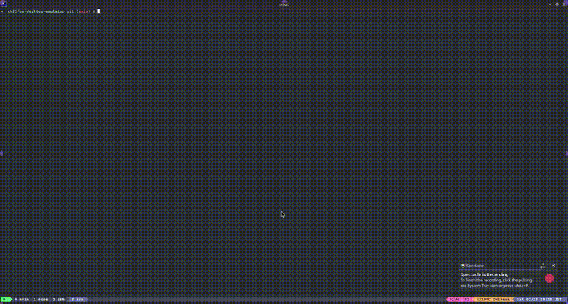

# CH32fun Desktop Emulator

[日本語版 README](docs/README.ja.md)

Terminal emulator for a CH32fun-based firmware ELF. It renders the SSD1306-style OLED at its full 128x64 resolution using the Kitty graphics protocol or Sixel.

## Demo



## Features

- Loads a firmware `.elf` image at runtime
- Emulates the CPU, flash, RAM, I2C traffic, button input, and OLED VRAM
- Synchronizes the emulated QingKe CPU to 48 MHz and I2C1 to its configured 1 MHz bus rate
- Displays the full-resolution OLED framebuffer using Kitty or Sixel terminal graphics
- Uses crisp nearest-neighbor scaling, white pixels, and top/left display margins
- Compresses Kitty frames with zlib and sends only changed VRAM to reduce terminal load
- Supports headless execution for quick inspection and debugging
- Uses only the Zig standard library

## Requirements

- Zig 0.17
- A terminal with Kitty graphics or Sixel support

## Build

```sh
zig build
```

Run the emulator tests with `zig build test`.

This builds:

- `zig-out/bin/ch32fun-desktop-emulator`

## Install the `chemu` command

```sh
scripts/install.sh
```

This installs `chemu` and a ReleaseFast-optimized emulator executable to `~/.local/bin`. Set
`PREFIX` or `BINDIR` to use another location.

From a `ch32fun_zig` project directory, build and run its firmware with:

```sh
chemu
```

The command runs `zig build`, detects the RISC-V ELF in `zig-out/bin`, and
starts the emulator with automatic graphics selection at 60 FPS by default. Useful launcher options include:

- `--no-build`: run an existing artifact without rebuilding
- `--firmware PATH`: select an ELF explicitly when the project produces more than one

Emulator options can follow the launcher options:

```sh
chemu --graphics sixel --target-fps 30
```

## Usage

Run the emulator with a firmware ELF:

```sh
zig build run -- --elf /path/to/firmware.elf
```

Useful options:

- `--stats`: print actual FPS, instruction rate, terminal output rate, and other statistics once per second
- `--cpu-slice N`: number of CPU steps per execution slice
- `--target-fps N`: UI presentation target
- `--graphics auto|kitty|sixel`: select the terminal graphics protocol
- `--kitty-transport auto|direct|tmux`: select Kitty transport (default: auto)
- `--headless`: run without terminal graphics
- `--steps N`: number of instructions to execute in headless mode
- `--dump-oled`: print the OLED framebuffer as ASCII after headless execution

Example:

```sh
zig build run -- --elf /path/to/firmware.elf --stats
```

The defaults are tuned for efficiency. Lowering `--cpu-slice` can reduce input
latency, but increases CPU usage by performing more sleeps and clock queries.

Headless example:

```sh
zig build run -- --elf /path/to/firmware.elf --headless --steps 200000 --dump-oled
```

## Controls

- `Left` / `Right`: rotate the emulated quadrature encoder one detent counterclockwise/clockwise (phase A: PA2, phase B: PD5)
- `Space`: press/release the emulated button (true key-up on Kitty keyboard capable terminals; a 600 ms pulse otherwise, sufficient for a 500 ms long-press threshold)
- `d`: hold the tact switch down
- `u`: release the tact switch
- `Esc`, `q`, or `Ctrl-C`: quit

## Ghostty and tmux

Use the same command in Ghostty and Ghostty + tmux:

```sh
chemu --stats --target-fps 60
# Explicit selection also works when terminal hints are missing:
chemu --graphics kitty --stats --target-fps 30
```

For tmux, add this to `~/.tmux.conf` and reload the configuration:

```tmux
set -g allow-passthrough on
```

`--graphics auto` recognizes `xterm-ghostty`, `TERM_PROGRAM=ghostty`,
`GHOSTTY_RESOURCES_DIR`, and Kitty's TERM/window hints. These are hints, not a
capability guarantee. tmux can replace TERM/TERM_PROGRAM; the inherited
`GHOSTTY_RESOURCES_DIR` or `KITTY_WINDOW_ID` still identifies the outer terminal.
If hints are absent, auto queries Kitty support directly, then through tmux
passthrough when applicable (up to 60 ms per route). Without a positive reply,
explicit selection is required rather than sending unsolicited images.
A TERM containing `sixel` selects Sixel; `--graphics sixel` remains supported.
Headless execution performs no terminal detection or graphics output.

Inside `TMUX`, automatic Kitty transport makes a bounded 60 ms native graphics
query once at startup. A positive reply selects direct APC output; otherwise
it wraps each APC chunk (including deletion) in tmux DCS passthrough and doubles
its ESC bytes. Known terminals outside tmux keep direct output without probing. The normal
keyboard protocol stays on the pane side of tmux. To force a known route:

```sh
chemu --graphics kitty --kitty-transport tmux
chemu --graphics kitty --kitty-transport direct
```

If the image is missing, check `tmux show -gv allow-passthrough`, inherited
terminal hints, and the explicit options above. A failed/slow native query
falls back to passthrough; it does not prove passthrough is enabled. SSH and
nested multiplexers may require additional configuration; nested tmux wrapping
is not implemented. tmux passthrough uses Kitty Unicode placeholders (`U=1`): image data passes
through DCS, but the visible cells go through tmux's normal text grid. This keeps
the display attached to its pane across pane/window switches, clipping and
redraws. Ghostty 1.4.0 and Kitty support this protocol extension; other terminals
need Unicode-placeholder support, not just basic Kitty graphics. Direct/native
transport keeps regular placements. Each instance uses a random nonzero 24-bit
image ID, and exit frees only that image. Resize redraws the placeholder grid;
small panes clip the 64×16-cell image to the available space. The grid is emitted
once per layout change, and `--stats` stays on the top line so it cannot scroll
the image cells away.

Space uses a 600 ms renewable pulse inside tmux, including enhanced keyboard
presses, so a missing release cannot leave it stuck. Real release ends the pulse
early. Outside tmux enhanced keyboard events retain true press/release behavior.
For an indefinite hold in tmux use `d`, then `u` to release.

Validation status: macOS, Zig 0.17.1; unit and synthetic PTY tests cover direct
Kitty, passthrough, native-query selection, Sixel, headless, and terminal cleanup.
Ghostty 1.4.0 + tmux 3.7b is the reported target environment; actual image display,
flicker, physical key behavior, and end-to-end input latency still require manual
verification. Other Kitty/Sixel terminals are not visually verified.
See [validation](#validation) below for reproducible measurements and limits.

## Validation

Reproduce the synthetic firmware and PTY checks on macOS:

```sh
zig build test
zig build -Doptimize=ReleaseFast
zig cc -target riscv32-freestanding -mcpu=generic_rv32 -nostdlib \
  -Wl,-T,tests/firmware.ld tests/animated_oled.S -o /tmp/chemu-animated.elf
python3 tests/terminal_regression.py
python3 tests/terminal_regression.py --through-tmux --target-fps 30
python3 tests/terminal_regression.py --through-tmux --target-fps 60
```

The firmware continuously changes OLED VRAM through I2C; its first pixel mirrors
PD1 so the harness can verify button press/hold/release through the CPU and OLED.
It is a synthetic transport workload, not a timing-accurate CH32fun game.
The harness reconstructs chunks, decodes base64/zlib RGB, verifies changed frames
and image deletion, checks termios/keyboard/cursor cleanup on q/Esc/Ctrl-C, and
runs Sixel/headless regressions. It also simulates native and passthrough query
replies with no terminal environment hints. `--through-tmux` starts an isolated
tmux server with passthrough enabled and verifies the outgoing APC stream.
It never changes the user's tmux server settings. The tmux regression also
splits panes, selects another pane/window, and checks that placeholder cells
remain in the owning pane and are absent from the other pane/window. This checks
tmux's cell ownership and virtual-only image commands, not Ghostty's renderer.

Baseline measurements before the Unicode-placeholder pane fix, on macOS with
Zig 0.17.1 ReleaseFast, three seconds per run (not current pane-fix measurements):

| Target | Transport to PTY | FPS from stats | Million steps/s | Graphics KiB/s | Sampled RSS KiB | Press / release to PTY (ms) |
| --- | --- | ---: | ---: | ---: | ---: | ---: |
| 30 | Direct | 29.0 | 28.83 | 8.05 | 2592 | 22.21 / 28.20 |
| 30 | DCS | 29.0 | 28.83 | 8.37 | 2592 | 38.80 / 30.21 |
| 60 | Direct | 58.0 | 28.83 | 16.10 | 2592 | 11.19 / 28.46 |
| 60 | DCS | 57.3 | 28.83 | 16.53 | 2592 | 19.63 / 42.04 |
| 30 | Actual tmux 3.7b → PTY | 29.0 | 28.83 | 8.30 | 3104* | 23.36 / 26.78 |
| 60 | Actual tmux 3.7b → PTY | 58.0 | 28.83 | 16.75 | 3088* | 30.13 / 28.02 |

Direct and DCS rows compare the two routes in the updated implementation, not
an earlier release. Stats cover steady-state sampling windows; frame totals
include startup. Output counts now include Kitty APC headers, terminators,
cursor positioning, and DCS overhead (older versions counted only base64).
DCS adds 11 bytes per image APC. Memory is sampled with `ps`, not an allocation
profiler; *actual-tmux rows sample the tmux client, not emulator/whole server RSS.
Latency has only one press/release sample per run and includes firmware and
harness scheduling. It ends at the PTY, not physical display refresh. Short
runs cannot establish worst-case latency or statistical performance equivalence.

After the pane fix, all 22 Zig tests passed with Zig 0.17.0 and 0.17.1.
The split-pane/window regression passed through actual tmux 3.7b at both 30
and 60 FPS targets (stats: 29/58 FPS; about 28.83 million instructions/s).
The placeholder grid costs roughly 8 KiB once per layout change; resize/split
checks deliberately trigger additional grid output. In these short runs,
startup and resize traffic raises the reported output average. Uploading frames
with an unchanged layout does not resend the grid.

 CPU execution, zlib compression,
nearest-neighbor scaling, and VRAM-change suppression remain in place. Ghostty
UI automation was denied by the computer-use tool, so actual Ghostty rendering,
flicker/residual images, and physical key behavior are **not verified**. Manual
checks on Ghostty 1.4.0 alone and with tmux 3.7b remain necessary before treating
the visual issue as confirmed resolved.

## Helper Script

[`tools/run-mopeck.sh`](tools/run-mopeck.sh) builds the related Mopeck firmware project and then launches this emulator with:

```sh
tools/run-mopeck.sh
```

The script uses these environment variables when needed:

- `MOPECK_DIR`
- `EMULATOR_DIR`

## Project Layout

- `src/`: emulator implementation
- `tools/`: helper scripts

## License

Add a license before publishing on GitHub if you want to allow reuse.
