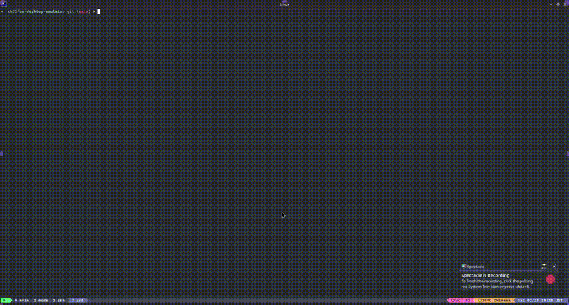

# CH32fun Desktop Emulator

[English README](../README.md)

CH32fun ベースのファームウェア ELF を端末上で実行するエミュレータです。SSD1306 風 OLEDをKitty Graphics ProtocolまたはSixelで128x64のまま表示します。

## デモ



## 機能

- 実行時にファームウェア `.elf` を読み込み
- CPU、flash、RAM、I2C 通信、ボタン入力、OLED VRAM をエミュレーション
- QingKe CPUを48 MHz、I2C1を設定値の1 MHzに同期して実行
- OLED フレームバッファをKittyまたはSixel対応端末へ高解像度表示
- 白色ピクセルを最近傍拡大し、上側・左側に余白を付けて鮮明に表示
- Kitty描画をzlib圧縮し、VRAM変更時だけ送信して端末負荷を抑制
- デバッグ向けの headless 実行をサポート
- Zig標準ライブラリのみを使用

## 必要環境

- Zig 0.17
- Kitty GraphicsまたはSixel対応端末

## ビルド

```sh
zig build
```

`zig build test` でエミュレータのテストを実行できます。

生成物:

- `zig-out/bin/ch32fun-desktop-emulator`

## `chemu`コマンドのインストール

```sh
scripts/install.sh
```

既定では`chemu`とReleaseFastで最適化したエミュレーター本体を`~/.local/bin`へインストールします。別の場所へ配置する場合は`PREFIX`または`BINDIR`を指定できます。

`ch32fun_zig`ベースのプロジェクト直下で次を実行します。

```sh
chemu
```

`zig build`を実行し、`zig-out/bin`内のRISC-V ELFを検出して、既定で描画方式の自動選択・60 FPSのエミュレーターを起動します。

- `--no-build`: 再ビルドせず既存の成果物を実行
- `--firmware PATH`: 複数のELFがある場合に明示選択

ランチャーオプションの後ろにはエミュレーターのオプションを指定できます。

```sh
chemu --graphics sixel --target-fps 30
```

## 使い方

ファームウェア ELF を指定して起動します。

```sh
zig build run -- --elf /path/to/firmware.elf
```

主なオプション:

- `--stats`: 1 秒ごとに実描画FPS、命令数、端末転送量などを表示
- `--cpu-slice N`: 1 スライスあたりの CPU 実行ステップ数
- `--target-fps N`: UI 表示更新の目標 FPS
- `--graphics auto|kitty|sixel`: 端末画像プロトコルを選択
- `--kitty-transport auto|direct|tmux`: Kitty送信経路（既定: auto）
- `--headless`: 端末画像を表示せずに実行
- `--steps N`: headless 実行時の命令実行数
- `--dump-oled`: headless 実行後に OLED 内容を ASCII で出力

例:

```sh
zig build run -- --elf /path/to/firmware.elf --stats
```

通常は既定値のままが最も効率的です。`--cpu-slice`を小さくすると入力遅延を短縮できますが、sleepと時刻取得の回数が増えてCPU負荷が高くなります。

headless 実行例:

```sh
zig build run -- --elf /path/to/firmware.elf --headless --steps 200000 --dump-oled
```

## 操作

- `←` / `→`: ロータリーエンコーダーを反時計回り／時計回りに1クリック回転（A相: PA2、B相: PD5）
- `Space`: タクトスイッチを押下・解放（Kitty keyboard対応端末では実際のkey-up、それ以外およびtmux内では600 msのパルス）
- `d`: タクトスイッチを押した状態にする
- `u`: タクトスイッチを解放する
- `Esc`、`q`、`Ctrl-C`: 終了

## Ghosttyとtmux

Ghostty単体でもtmux内でも同じコマンドを使用できます。

```sh
chemu --stats --target-fps 60
# 環境変数から判定できない場合:
chemu --graphics kitty --stats --target-fps 30
```

tmuxでは`~/.tmux.conf`に以下を追加して設定を再読み込みします。

```tmux
set -g allow-passthrough on
```

自動判定は`TERM=xterm-ghostty`、`TERM_PROGRAM=ghostty`、
`GHOSTTY_RESOURCES_DIR`、KittyのTERMや`KITTY_WINDOW_ID`を認識します。
これらは機能の保証ではなく判定のヒントです。tmuxでTERM等が上書きされても、
継承された`GHOSTTY_RESOURCES_DIR`等を利用できます。ヒントがない場合は直接、続いてtmuxパススルー経由でKitty機能を
問い合わせます（各経路最大60ms）。対応応答がない端末には画像を自動送信せず、
明示指定を求めます。TERMに`sixel`を含む場合はSixelを選択します。
`--graphics sixel`および端末機能に依存しない`--headless`も引き続き利用できます。

`TMUX`内での自動送信経路は、起動時に最大60msのネイティブKitty機能問い合わせを
行います。対応応答があれば直接APC、なければ各画像チャンクと削除命令をDCS
パススルーで包み、内部ESCを二重化します。判定済みの端末ではtmux外で従来どおり直接送信し、
問い合わせは行いません。キーボード初期化はtmuxのペイン側に送ります。
送信経路を固定する場合:

```sh
chemu --graphics kitty --kitty-transport tmux
chemu --graphics kitty --kitty-transport direct
```

表示されない場合は`tmux show -gv allow-passthrough`、環境変数の継承、上記の
明示指定を確認してください。問い合わせの無応答はパススルーの有効性を保証しません。
SSHや多重tmuxは追加設定が必要な場合があり、多重ラッピングは未対応です。
tmux経由ではUnicodeプレースホルダー（`U=1`）を使用します。画像データはDCS経由、
表示位置は通常の文字セルとしてtmuxに渡し、ペーン・ウィンドウ切替時の再描画に追従させます。
Ghostty 1.4.0とKittyに対応し、他端末では基本Kitty機能に加えてプレースホルダー対応が必要です。
直接送信・ネイティブ経路は従来の画像配置を維持します。
起動ごとにランダムな24bit画像IDを割り当て、終了時は自分の画像だけを解放します。
リサイズ時にセルを再配置し、小さなペーンでは画像を表示領域内に切り詰めます。
セルの送信はレイアウト変更時のみで、統計表示は画像をスクロールさせない上端1行とします。

tmux内のSpaceは拡張キー入力でも600msのパルスとし、繰り返し入力で延長します。
リリースを受信すれば即座に解放します。無期限の長押しには`d`と`u`を使用してください。
Ghostty単体の拡張キー入力では従来の押下・解放動作を維持します。

検証状況: macOS / Zig 0.17.1で単体テストと合成PTYテストを実施。
直接Kitty、パススルー、ネイティブ応答による経路選択、Sixel、headless、端末復元を
検証します。Ghostty 1.4.0 + tmux 3.7bは報告された対象環境です。
画像の実表示、ちらつき、実キー操作、入力から表示までの遅延は実機未検証です。
他のKitty/Sixel端末も実表示未検証です。
再現手順と測定の制約は[検証記録](../README.md#validation)を参照してください。

### 性能・回帰テスト

以下はプレースホルダー修正前の測定値です。専用ファームウェアでOLEDを連続更新し、30/60 FPSで直接送信とDCSを比較しました。
実測は約29/58 FPS、約2,883万step/s、RSS約2.5 MiBで、DCS転送量は約3–4%増加しました。
実際のtmux 3.7bを経由したPTYでも約29/58 FPSで画像データを復号できました。
これはGhosttyの実表示を確認した結果ではありません。

`zig build test`に加え、英語READMEの[検証手順と測定表](../README.md#validation)に
合成PTY回帰テストの再現コマンドを記載しています。Zig 0.17.0 / 0.17.1で単体テストを実施。
左右エンコーダー、600msパルス、拡張キー入力、d/uによる長押し・解放、終了キーを検証し、
PTYでは画像データ更新、Sixel/headless、終了時の端末状態復元も確認します。
入力遅延はPTY到着までの少数サンプルで、実画面表示までの遅延ではありません。
Ghosttyアプリへの操作はComputer Useの安全制限で拒否されたため、実表示・ちらつき・
物理キー動作は未検証です。他端末、多重tmuxも未確認です。
修正後はZig 0.17.0 / 0.17.1で全22件の単体テストが成功しました。
実tmuxの切替回帰テストも30/60 FPS指定で成功し、統計は約29/58 FPS、約2,883万step/sです。
プレースホルダーの追加送信はレイアウト変更ごとに約8 KiBで、毎フレームは再送しません。
追加の実tmux回帰テストではペーン分割・ペーン切替・別ウィンドウへの切替を行い、
画像セルが元のペーンに属し、他のペーンやウィンドウには混入しないことを検証します。
これはtmuxの文字セル管理の検証であり、Ghosttyの実表示の確認とは区別します。

## 補助スクリプト

[`tools/run-mopeck.sh`](../tools/run-mopeck.sh) は、関連する Mopeck ファームウェアプロジェクトをビルドしてから、このエミュレータを起動します。

```sh
tools/run-mopeck.sh
```

必要に応じて以下の環境変数を使えます。

- `MOPECK_DIR`
- `EMULATOR_DIR`

## ディレクトリ構成

- `src/`: エミュレータ本体
- `tools/`: 補助スクリプト

## ライセンス

GitHub で公開する前に、再利用を許可するならライセンスファイルを追加してください。
